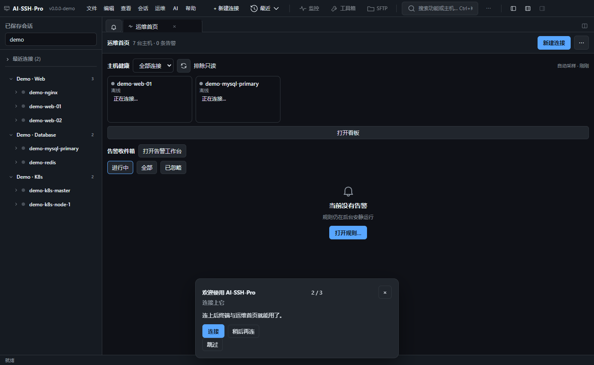
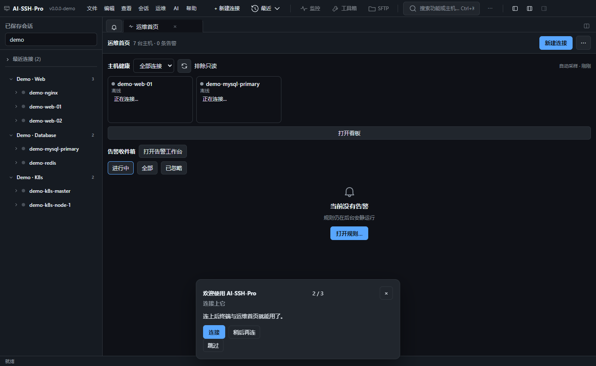
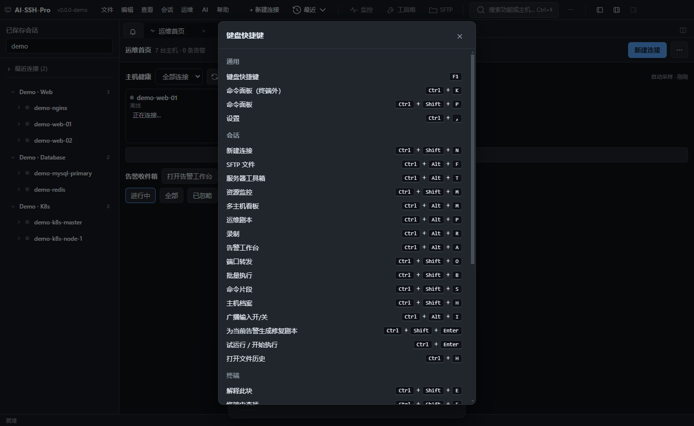

# AI-SSH-Pro

类 Xshell 的多会话 SSH 客户端，集成 AI 对话（Electron + TypeScript + React）。

[](./LICENSE)

[English](./README.md)

> **隐私：** SSH 密码、私钥和 LLM API Key 只保存在你的电脑上
> （应用 userData 目录下的 `electron-store` / 操作系统安全存储）。它们**不是**
> 本仓库的一部分。不要提交 `.env`、密钥文件，或包含机密的会话导出文件。

英文 README 中的原文如下，含义相同：

> **Privacy:** SSH passwords, private keys, and LLM API keys are stored only on your machine
> (`electron-store` / OS secure storage under the app userData directory). They are **not**
> part of this repository. Do not commit `.env`, key files, or exported session dumps that
> contain secrets.

## 截图

> 均为演示数据（`scripts/screenshot-demo.mjs` 在隔离配置中用虚构主机渲染）。

| 深色 | 浅色 |
| --- | --- |
|  |  |



## 功能

- **多标签 SSH** — 密码 / 私钥认证、xterm 终端、会话分组
- **SFTP** — 在当前 SSH 会话上浏览和传输文件
- **ProxyJump** — 经跳板机连接
- **端口转发** — 本地端口转发
- **主机密钥** — 首次连接确认指纹，变更时告警
- **加密机密** — 会话密码、密钥口令和 API Key 使用 Electron `safeStorage`
- **保活与重连** — SSH keepalive，断开后可一键重连
- **AI Core-A** — 观察 → 计划 → **命令仅在确认后执行**；终端快照自动读取
- **终端外观** — 字体、主题等
- **命令片段** — 可复用的命令片段
- **会话导入 / 导出** — Xshell `.xsh`、OpenSSH `config`、PuTTY
- **分屏** — 同一会话并排终端
- **录制** — 保存终端输出
- **本机 Shell** — 可选本地 PTY（依赖 `node-pty`，可能需要重新编译）
- **主机档案** — 本地主机知识库（服务、笔记）；AI 与 MCP 共用同一套文件
- **批量执行** — 勾选多个已连接 SSH 会话，点击「执行」后对它们运行同一条命令，并按会话显示结果
- **命令历史** — 本地保存最近约 200 条命令；命令栏支持上方向键和补全建议
- **最近连接** — 记录成功连接的主机、用户、端口、标签和时间，可加书签。不保存密码和密钥；若已有同主机的已保存会话，快速连接会复用其中的凭据
- **界面语言** — 简体中文（默认）和 English，覆盖主界面和上述新功能，偏好保存在本机
- **服务器工具箱**（会话 → 服务器工具箱…，`Ctrl+Shift+T`）— 针对已连接的 Linux 主机：进程列表（过滤 / 排序，结束或强制结束）；systemd 服务（失败服务标记、查看状态、启动 / 停止 / 重启）；监听端口（`ss`/`netstat`），一键「转发到本机」；日志查看（日志文件或 journal，关键字高亮、级别筛选、每 3 秒跟随）。所有操作都会先确认，可选「使用 sudo」通过 `sudo -n` 执行
- **资源监控** — CPU、内存、Swap、负载、磁盘和运行时长，每 5 秒刷新，并显示最近 5 分钟的 CPU / 内存趋势
- **端口转发管理** — 在已连接会话上添加、停止本地转发，查看每条转发的连接数和流量
- **加密备份** — 把会话、文件夹和命令片段导出为一个带密码的文件（AES-256-GCM），可在另一台机器上恢复

## 开发

```bash
npm install
npm run dev
```

类型检查：

```bash
npm run typecheck
```

打包（在 Windows 上生成 NSIS 安装包和解压目录；在 macOS 上可生成 DMG）：

```bash
npm run dist
```

产物在 `release/`。

## 主机档案与 MCP

主机档案在本地磁盘上（没有云同步）：

- 默认目录：`~/.ai-ssh-pro/inventory`
- 可用环境变量 `AISS_INVENTORY_ROOT` 覆盖
- 结构：`index.json` + `hosts/{id}/meta.json`、`services.json`、`notes.md`

应用内：工具栏或菜单中的主机档案，或在已保存会话上右键打开。用「关联当前会话」把档案和会话连起来。当前标签会把 `hostInventoryId` / `inventoryLookup` 传给 AI 对话。

### MCP 服务

独立的 stdio MCP 服务（文件布局与应用相同）：

```bash
npm run mcp:inventory
# 或
node scripts/mcp-inventory-server.mjs
```

命令行自检：

```bash
node scripts/mcp-inventory-server.mjs --list
node scripts/mcp-inventory-server.mjs --export inventory-backup.json
node scripts/mcp-inventory-server.mjs --import inventory-backup.json
```

Cursor / Claude Desktop 配置示例：

```json
{
  "mcpServers": {
    "ai-ssh-pro-inventory": {
      "command": "node",
      "args": ["/absolute/path/to/ai-ssh-pro/scripts/mcp-inventory-server.mjs"],
      "env": {
        "AISS_INVENTORY_ROOT": "/home/YOU/.ai-ssh-pro/inventory"
      }
    }
  }
}
```

工具：`list_hosts`、`get_host`、`search_hosts`、`upsert_host`、`upsert_service`、`append_note`。

## AI 配置

1. 从菜单或工具栏打开 **AI 配置**
2. 填写 OpenAI 兼容的 Provider（例如 DashScope 的 `.../compatible-mode/v1`）和 API Key
3. Core-A 默认开启（`useOpenClaw`）；关闭后为单次流式对话

可选环境变量：

| 变量 | 说明 |
|----------|-------------|
| `BBS_AI_AUDIT_MODEL` | 默认模型名（否则为 `qwen-max`） |
| `AISS_MAX_POLLS` | Core-A 最大步数（默认 `10`） |
| `AISS_INVENTORY_ROOT` | 覆盖主机档案目录 |

## 安全说明

- 密码、密钥口令和 API Key 使用操作系统安全存储加密（例如 Windows DPAPI）。如果加密不可用，应用可能回退到明文并在控制台给出警告。
- 主机密钥存在单独的存储：`ai-ssh-pro-known-hosts`。
- 不要在不受信任的机器上保存生产凭据。
- **没有云同步。** 用 JSON 会话导入/导出做备份；没有远程账号或同步服务。
- 最近连接只保存主机、用户、端口、标签和时间，不保存密码、密钥路径或口令。
- 命令历史把你选择发送的命令保存在同一套本地存储中（大约 200 条）。如果命令文本里包含机密，它会留在本机，直到你清空历史。
- 没有遥测。

## 串口

AI-SSH-Pro **不支持**硬件串口（COM / ttyUSB / cu.*）。请用**本机 Shell**，或在系统终端使用外部串口工具。菜单 **文件 → 串口…** / Ctrl+K 可再次查看说明。

## 本机 Shell（`node-pty`）

本机 Shell 依赖可选包 `node-pty`。`npm install` 之后，可能需要为 Electron 重新编译原生模块，例如：

```bash
npx electron-rebuild -f -w node-pty
```

如果 `node-pty` 安装或编译失败，SSH 和其余功能仍然可用，只是没有本机 Shell。

## 目录

- `src/main` — Electron 主进程（SSH、AI、存储）
- `src/preload` — `window.aiss` 桥
- `src/renderer` — React 界面
- `src/shared/ipc.ts` — 共享类型与 IPC 协议
- `src/shared/workspace-features.ts` — 批量执行、命令历史、最近连接、语言的纯函数

## 参与贡献

见 [CONTRIBUTING.md](./CONTRIBUTING.md)。安全问题见 [SECURITY.md](./SECURITY.md)。

## 许可证

[MIT](./LICENSE)
