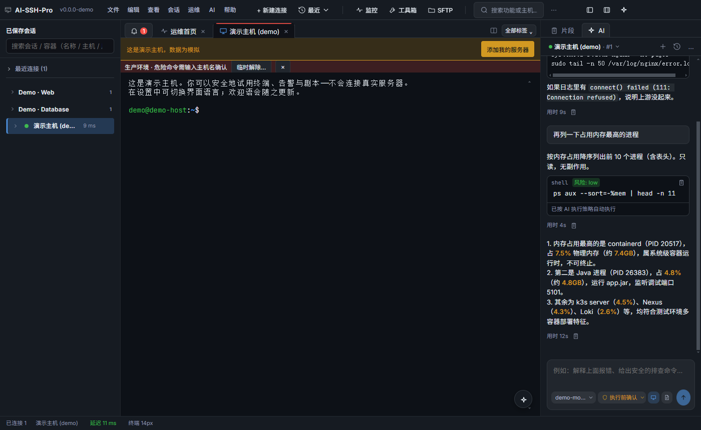
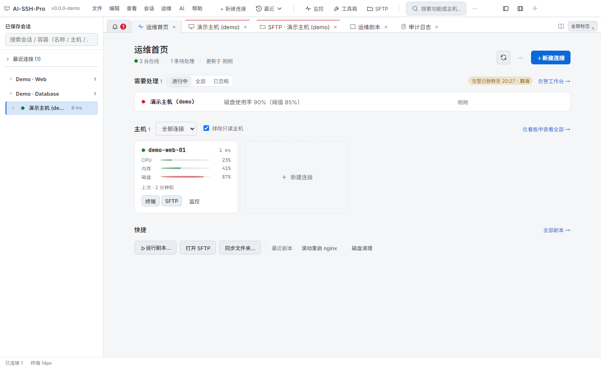
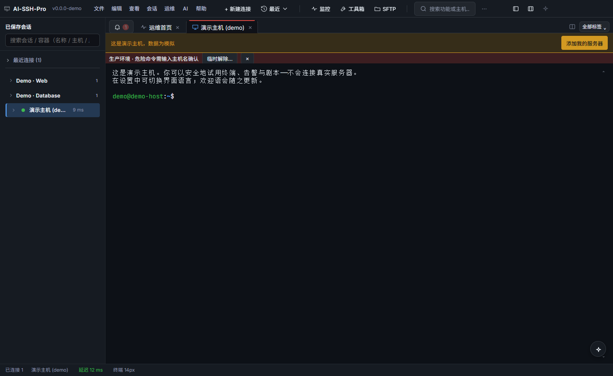
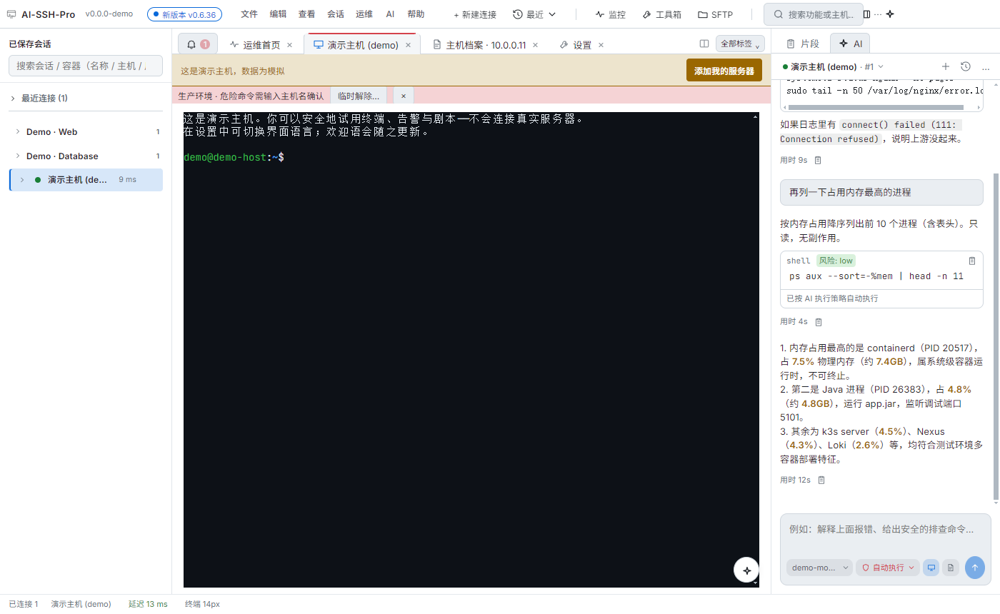
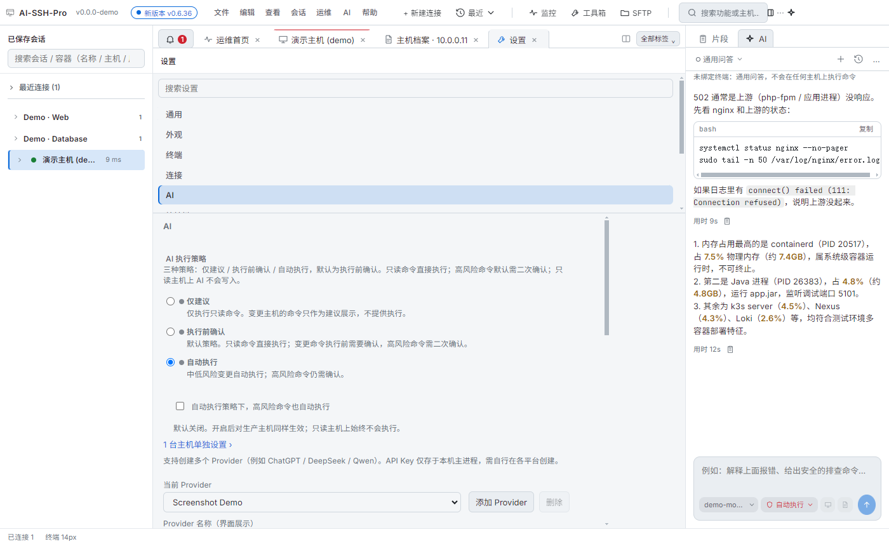
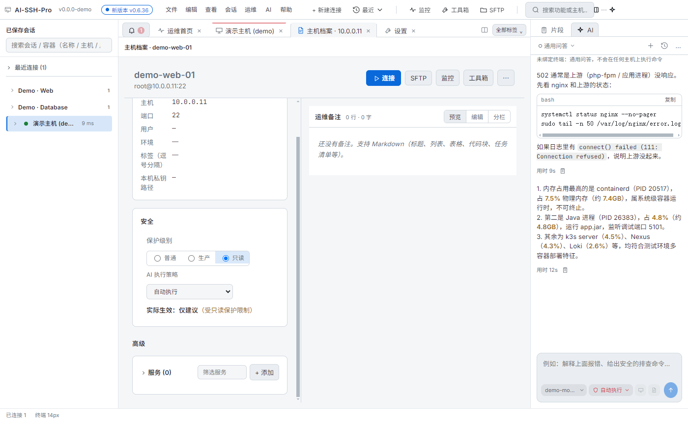
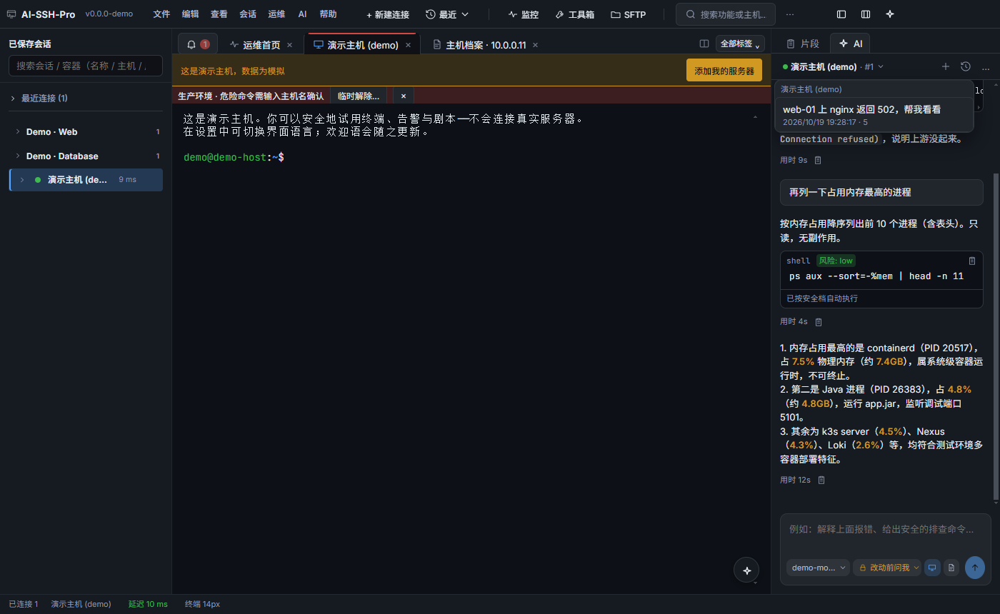
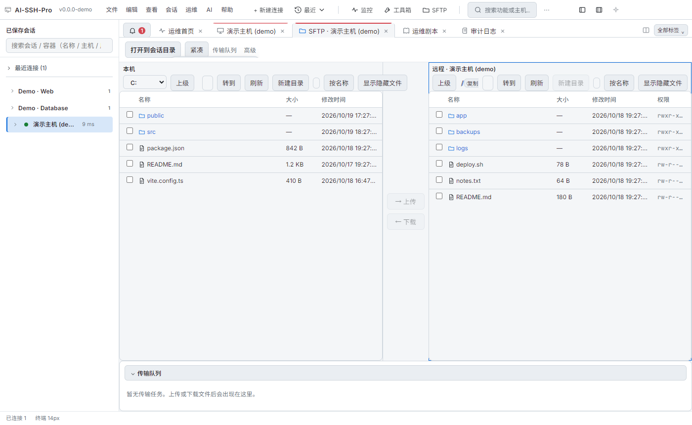
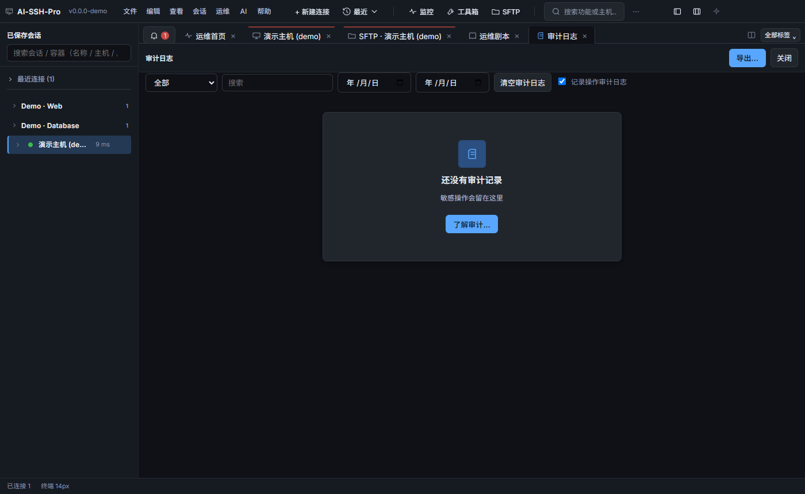

# AI-SSH-Pro：带 AI 助手、默认安全的多会话 SSH 桌面客户端

> 一句话介绍：AI-SSH-Pro 是一款本地运行的多会话 SSH 客户端，集成了 Cursor 风格的 AI 运维助手。AI 给出建议，执行策略由你决定：仅建议、执行前确认或自动执行。

- 官网：https://guoshuaipeng.github.io/ai-ssh-pro/
- 下载：https://github.com/guoshuaipeng/ai-ssh-pro/releases
- 开源协议：MIT

---

## 一、适合谁

- **运维 / SRE**：每天同时盯好几台机器，要一个界面看全状态。
- **后端开发**：经常上服务器查日志、重启服务，希望 AI 帮你把排查步骤理清楚。
- **小团队负责人**：想用 AI，又希望每台主机的执行权限可控。
- **从 Xshell / FinalShell 迁移的用户**：熟悉多标签、会话树的操作方式。

---

## 二、核心能力

### 1. 运维首页：一眼看清所有主机

打开就是运维首页：

- 在线主机数、待处理告警，放在最上面。
- 每台主机一张卡片，显示 CPU、内存、磁盘的实时指标。
- 卡片上一键进入终端、SFTP、监控。
- 常用运维剧本（如滚动重启 nginx、磁盘清理）放在快捷区。

### 2. 多会话 SSH 与标签页

- 多标签、分屏、会话分组，支持搜索和 #标签 过滤。
- 支持跳板机（多级 ProxyJump）、端口转发、主机密钥确认。
- 可导入 `~/.ssh/config`，最近连接一键重连。
- 生产主机的标签页带醒目横幅，时刻提醒当前环境。

### 3. AI 助手：Cursor 风格的右侧面板

AI 面板常驻终端右侧，排障时不用切窗口。

- 你的提问是浅色气泡，AI 回复是干净的正文，不堆卡片。
- 建议命令合并成一个紧凑代码块，带 **复制 / 执行** 和风险标签（低 / 中 / 高）。
- 每条回复下方显示耗时，可一键复制。
- 输入区一行完成：模型、执行策略、附带终端输出、发送；模型与策略均为主题化弹出菜单。

### 4. 三档 AI 执行策略

在 **设置 → AI** 里选一档就行：

| 策略 | 行为 |
|---|---|
| 仅建议 | 仅执行只读命令，变更命令只作为建议展示 |
| 执行前确认（默认） | 只读命令直接执行，变更命令执行前需确认，高风险需二次确认 |
| 自动执行 | 中低风险自动执行，高风险仍需确认 |

- “自动执行”下可单独开启“高风险命令也自动执行”，默认关闭。
- 输入区的策略菜单可为当前标签页临时调整，只读主机上不可用的选项会直接注明原因。

### 5. 主机保护：每台主机单独设定

每台主机的设置里都有一张 **安全** 卡片：

- 保护级别：普通 / 生产 / 只读。
- 这台主机的 AI 策略：跟随全局，或单独选一档。
- 卡片直接显示**实际生效**的策略，例如：“实际生效：仅建议（受只读保护限制）”。

### 6. 对话绑定标签页，历史可找回

- 每个终端标签页是一段独立对话；同一主机开两个标签页，就是 #1、#2 两段。
- 点 **＋ 新对话** 会归档当前对话，不会直接删除。
- 历史对话按主机分组，点击即可恢复。
- 终端断开时提示“重新连接后继续”；没有绑定终端时是通用问答，不会执行任何命令。

### 7. SFTP 双栏与更多运维工具

- **SFTP 双栏**：本地与远程并排，拖拽上传下载，带传输队列。
- **监控**：资源监控、多主机看板、告警规则与告警工作台。
- **工具箱**：进程、端口、服务、日志、Docker 容器与 Compose。
- **效率**：命令片段、运维剧本、批量执行、多会话广播、会话录制与回放。
- **审计**：敏感操作留痕，可按时间筛选与导出。

---

## 三、安全设计

安全不是一个开关，而是几层叠加：

- **主进程兜底**：AI 写终端前，主进程会按主机保护再检查一次。只读主机即使点了同意，AI 也无法写入。
- **策略由你决定**：全局、主机、标签页三级设置，所选策略在任何主机上按原样生效；生产主机保留醒目横幅作为提醒。
- **一个规则，处处一致**：设置页、主机卡片、AI 输入区和后台执行用同一套规则计算实际策略，不会出现“界面说要确认、后台却直接跑”。
- **临时调整有边界**：可以为当前标签页临时调整策略，只保存在内存中，关闭或断开即恢复，仍受只读保护限制。
- **凭据只在本机**：密码、私钥口令、API Key 用系统安全存储加密保存在本机，不上传到任何产品云端。可选的加密云同步默认不包含凭据；如手动勾选，凭据会在本机加密后再上传到你自己的私有 Gist 或 WebDAV。
- **全程可追溯**：AI 发起的命令和危险操作都记入审计日志。

---

## 四、下载安装

1. 打开 GitHub Release 页面：https://github.com/guoshuaipeng/ai-ssh-pro/releases
2. 下载最新版本的安装包（以 Release 页面实际提供的文件为准）。
3. 安装后启动，可以先连内置的**演示主机**体验，数据全部模拟，不会连接真实服务器。
4. 在 **设置 → AI** 填入你自己的模型 Provider（支持 OpenAI 兼容接口，如 DeepSeek、通义千问等）。

更多介绍与使用说明见官网：https://guoshuaipeng.github.io/ai-ssh-pro/

---

## 五、最后

如果你想要一款**顺手的多会话 SSH**，又希望 AI **给出方案、由你决定执行方式**，欢迎试试 AI-SSH-Pro。

- 觉得有用，欢迎到 GitHub 点个 Star。
- 遇到问题或有想法，直接提 Issue：https://github.com/guoshuaipeng/ai-ssh-pro/issues
